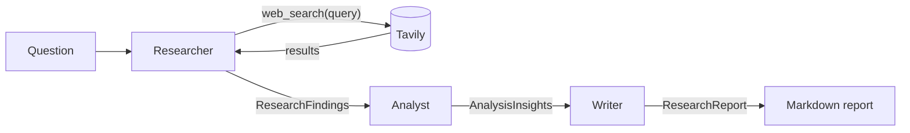

# Multi-Agent Research Pipeline

Three AI agents (Researcher, Analyst, Writer) work together to turn a question into a sourced research report.

## Overview

You ask a research question. A Researcher agent searches the web, an Analyst agent finds the key points, trends and gaps, and a Writer agent turns everything into a structured report saved as Markdown.

I built this project to understand how multi-agent systems work from the inside:

- **Agent roles:** each agent has one job and its own instructions.
- **Tool calling:** the Researcher decides when and what to search, and the code runs the search for it.
- **Structured communication:** agents pass validated data to each other, not free text.

The code is plain Python with no agent frameworks, so every step is visible and easy to follow.


## Architecture



| Agent | What it does | Output model |
| --- | --- | --- |
| **Researcher** | Runs a tool-calling loop: the LLM asks for `web_search` calls, the code runs them with Tavily and sends the results back, until the LLM has enough information or the search cap is hit. Then it returns structured findings. | `ResearchFindings`: question, list of `Source` (title, url, content), summary |
| **Analyst** | One structured LLM call over the findings. No tools. | `AnalysisInsights`: key points, trends, gaps |
| **Writer** | One structured LLM call over the findings and insights. Can take user feedback and rewrite. | `ResearchReport`: title, executive summary, sections, conclusion, sources |

All agents use `gpt-4o-mini` through the OpenAI API.

## Key design decisions

- **Pydantic models as contracts.** Every agent returns a Pydantic model, and the next agent receives it as JSON. The OpenAI structured output API (`chat.completions.parse`) makes the LLM reply in that exact shape, so each agent can trust its input.
- **A hand-written tool-calling loop.** No LangChain or CrewAI. The loop in [researcher.py](src/research_pipeline/agents/researcher.py) shows the real mechanics: tool schema, tool call, tool result message, repeat.
- **A cap on searches.** The Researcher runs at most 3 searches (`MAX_SEARCHES`), which keeps cost and runtime predictable.
- **Sources come from real search results.** After the Writer finishes, its sources are replaced with the Researcher's Tavily results, so the report cannot contain invented URLs.
- **The feedback loop reruns only the Writer.** When you ask for changes, the saved findings and insights are reused, so there are no extra searches or analysis calls.

## Tech stack

Python 3.11 (uv), OpenAI API (`gpt-4o-mini`), Tavily, Pydantic, Streamlit, python-dotenv.

## Setup

1. Clone the repository and install dependencies:

   ```bash
   git clone https://github.com/mitalin92/multi-agent-research.git
   cd multi-agent-research
   uv sync
   ```

2. Create a `.env` file in the project root with your API keys:

   ```
   OPENAI_API_KEY=your-openai-key
   TAVILY_API_KEY=your-tavily-key
   ```

   `.env` is listed in `.gitignore`, so your keys are never committed.

## Usage

**CLI:** pass the question as an argument. The report is saved to `outputs/`.

```bash
uv run main.py "What are the latest trends in AI for agriculture?"
```

**Streamlit app:** open the app in your browser and type a question into the chat box.

```bash
uv run streamlit run app.py
```

## Example output

An excerpt from a report generated for "What are the latest trends in AI for agriculture?":

> # Latest Trends in AI for Agriculture (2026)
>
> ## Executive Summary
>
> As of 2026, significant trends in AI for agriculture include the shift from monitoring tools to integrated decision systems, enhanced AI-user interaction through generative AI guidance, and a focus on standardized, actionable data systems that enable better farming decisions. [...]
>
> ## Current Gaps in AI Implementation
>
> Despite the advancements, there remain gaps in understanding how farmers are adapting to these AI technologies in their daily operations. [...]

Full report: [outputs/2026-11-09-latest-trends-in-ai-for-agriculture-2026.md](outputs/2026-11-09-latest-trends-in-ai-for-agriculture-2026.md)

## Project structure

```
multi-agent-research/
├── main.py                      # CLI entry point
├── app.py                       # Streamlit web app
├── src/research_pipeline/
│   ├── models.py                # Pydantic models (contracts between agents)
│   ├── tools.py                 # Tavily web search tool and its schema
│   └── agents/
│       ├── researcher.py        # Tool-calling loop, returns ResearchFindings
│       ├── analyst.py           # Returns AnalysisInsights
│       └── writer.py            # Returns ResearchReport, saves Markdown
├── notebooks/
│   └── test_pipeline.ipynb      # Step-by-step testing of each agent
├── outputs/                     # Generated reports
└── pyproject.toml
```

## Limitations and next steps

**Limitations**

- Reports are based only on public web results from a small number of searches, so they reflect what is online, not specific or private data.

**Next steps**

- **Document search tool (agentic RAG):** give the Researcher a second tool that searches a set of documents, so reports can be grounded in specific data.
- **Evaluation:** measure report quality, for example whether every claim is supported by a source.
